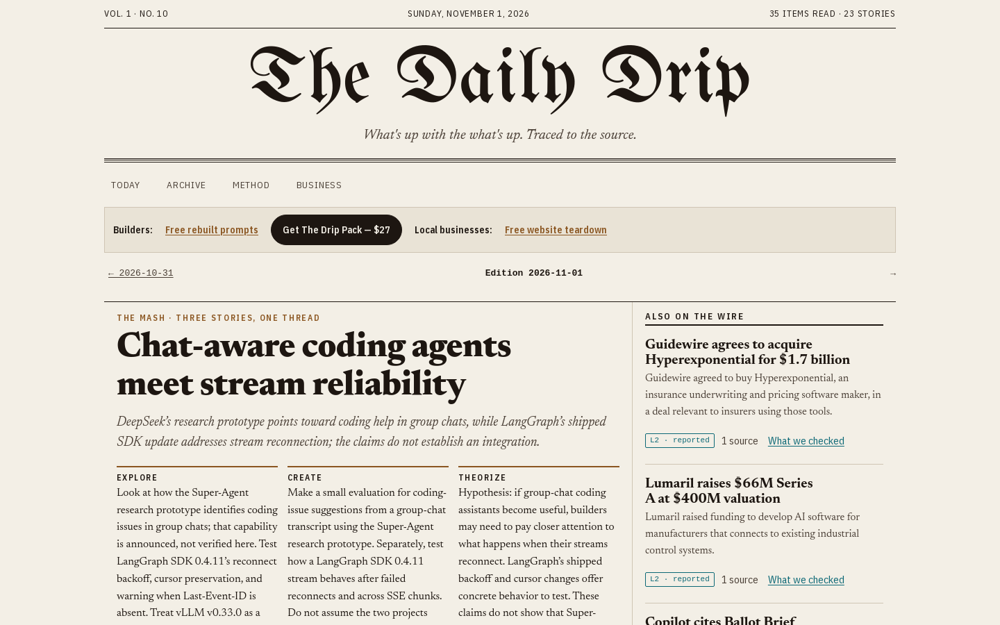
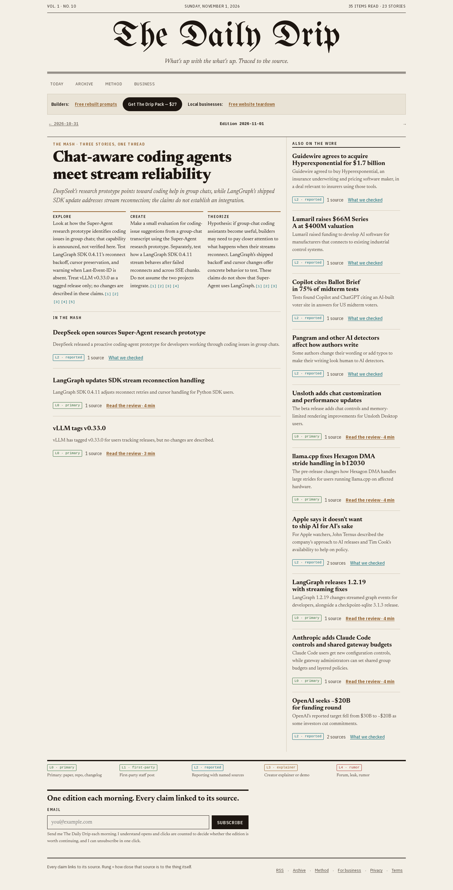

# The AI Drip

**Live product:** [https://the-ai-drip.com](https://the-ai-drip.com)

Claude Code–centered content brand: a daily auto-published edition for builders, plus a webinar / product funnel. Editorial layout presents traced AI and tooling news with clear source tiers — built for people who ship with agents.

This repository is a **public showcase only** (README + screenshots). Source code, env files, and secrets are not included.

## Screenshots

### Hero

### Full page

## What it is

- Daily auto-published edition for AI / agent builders
- Claude Code–focused positioning and builder tooling offers
- Webinar and product funnel layered on the content brand
- Public archive and method pages for readers and businesses

## Tech stack

| Layer | Stack |
|-------|--------|
| Content brand | Daily auto-published edition site |
| Focus | Claude Code / AI agent builders |
| Growth | Webinar funnel + digital product offers |
| Delivery | Production site at the-ai-drip.com |

## Links

- **Product:** https://the-ai-drip.com
- **Author:** [John Gantz](https://github.com/JohnGantz-dev) · Gantzter Designs

## License

MIT — see [LICENSE](LICENSE). Screenshots and copy in this repo are provided for portfolio display.
